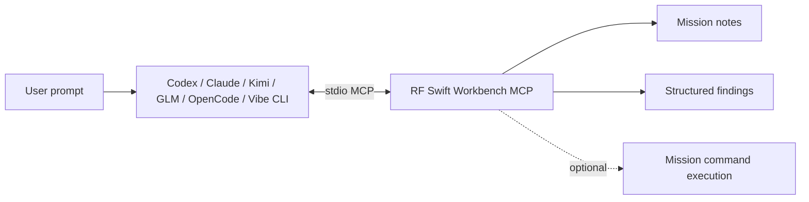

# RF Swift coding-agent integration (optional MCP)

RF Swift does not call a model API, select a model, store provider API keys, or
charge for AI usage. Instead, the Workbench exposes an optional local MCP server
to an external coding-agent CLI such as Codex, Claude Code, Kimi Code, GLM,
OpenCode or Mistral Vibe.
That CLI owns its authentication, subscription, model choice, and billing.



## Security model

The bridge is disabled by default and uses local standard input/output, so RF
Swift does not open an MCP network port. Each invocation can be restricted to a
single project and mission. Permissions are independent:

- Read-only exposes mission discovery, notes, and findings.
- Write access additionally exposes `write_note` and `save_finding`.
- Command access additionally exposes `execute_command`, the job tools and the
  interactive session tools inside the mission target. This is disabled by
  default and should only be enabled for an authorized assessment.
- RF transmission is a separate switch on top of command access (**Allow
  commands that transmit RF**, `--mcp-tx`). Without it, commands that transmit
  are refused; with it, each transmission must still be declared and described
  (see [RF transmission gate](#rf-transmission-gate)).
- Findings an agent saves are drafts: the agent cannot confirm a finding or
  change one the operator wrote (see [Agent findings](#agent-findings)).

Tools that are not permitted are omitted from `tools/list`, not merely rejected
after an agent tries them. Agent permissions are kept in the local RF Swift user
configuration and are not placed in exported projects; model credentials remain
entirely owned by the external client.

## Starting the server

For Codex, Claude Code, Kimi Code, OpenCode and Mistral Vibe, press
**Connect & launch** in the Agent panel. Workbench then:

1. Finds the selected CLI: the program path set for it in the Agent settings,
   otherwise `PATH`, then the user-level folders a desktop launcher's `PATH`
   often lacks (nvm and fnm Node versions, newest first, pnpm, yarn, deno and
   mise). Set the full path in the Agent settings (**Browse...** shows hidden
   folders such as `.nvm` and `.local`) for a CLI installed anywhere else. The
   CLI starts with its own folder first on `PATH`, so an npm-installed CLI
   finds the `node` next to it.
2. Creates or merges a private configuration under the mission's
   `agent-workspace` directory.
3. Performs a real MCP `initialize` handshake with the mission-scoped server.
4. Starts the client's interactive TUI in the embedded terminal.

Where each client finds its configuration in `agent-workspace`:

| Client | Command | Configuration | Approval without YOLO / with YOLO |
|---|---|---|---|
| Codex | `codex` | `.codex/config.toml` | asks; `--dangerously-bypass-approvals-and-sandbox` |
| Claude Code | `claude` | `.mcp.json` | asks; `--dangerously-skip-permissions` |
| Kimi Code | `kimi` | `.kimi-code/mcp.json` | asks; `--yolo` |
| OpenCode | `opencode` | `opencode.json`, merged over your global config | asks before edits, shell commands and web access (OpenCode allows them by default); `"permission": "allow"` |
| Mistral Vibe | `vibe` | `.vibe/config.toml`: a copy of your `~/.vibe/config.toml` (or `$VIBE_HOME`) plus the `rfswift` server, rebuilt on every connect, since Vibe reads a project config instead of the global one | its default agent auto-approves file edits in the launcher directory only; `--auto-approve` |

Mission data never goes through those approvals alone: write and command access
are enforced by the RF Swift MCP server itself.

While the TUI is connected, Workbench refreshes mission notes and findings
written by MCP so changes appear in their panels without switching missions.
The generated `AGENTS.md`/`CLAUDE.md` tells clients that phrases such as
"create a note" mean the mission `write_note` tool, not a loose file in the
launcher directory.

When an agent calls `execute_command`, Workbench opens a read-only **AI · tool**
terminal tab automatically. It displays the requested command immediately,
streams its real container or Nix output, and marks the final success/failure
state. This makes agent activity visible without mixing it into an operator's
interactive shell tab.

## Ground-truth AI audit

**Audit with AI** in the Security posture panel is deliberately a two-stage
workflow:

1. Workbench runs the deterministic Nix or container scanners and persists their
   unmodified JSON report as the mission's ground truth.
2. The connected agent reads that evidence with `read_audit`, consults
   `recommend_tools`, and may perform authorized non-destructive corroboration.

The agent is instructed to separate verified findings from hypotheses, never
invent CVEs, versions, output, exploitability, or CVSS metrics, and only save a
finding when scanner or observed command evidence supports it. Scanner severity
is retained as upstream evidence, but it is not presented as confirmed mission
exploitability. Runtime posture excludes build-time-only dependency matches;
those remain visible as supply-chain leads that require a demonstrated runtime
or release pathway. Nix vulnix
reports embed each matched CVE with its package, installed version, derivation,
score, severity, and description so the AI and GUI can cite the actual evidence
instead of relying on aggregate counts.

This audit concerns only the Nix closure or container image used as the RF
Swift tool environment. It is stored under `environment-audits/` and is never
included in mission finding totals or PwnDoc exports. Mission findings are
operator-validated vulnerabilities or bugs in the assessed IoT/RF target.
Environment CVEs cannot be promoted automatically into those findings.

From the Findings panel, **Suggest from evidence** asks the connected agent to
review all mission Markdown notes and registered artifact metadata through
`read_evidence_index`. It produces source-cited candidates for operator review;
it does not silently save findings, and artifact metadata alone is not treated
as proof of a vulnerability.

The client can still show its normal workspace-trust and tool-approval prompts.
Disconnecting closes the TUI and its MCP child process. The project-local files
remain so the next launch is reproducible. Claude uses `.mcp.json`, Kimi uses
`.kimi-code/mcp.json`, and Codex uses `.codex/config.toml`.

The Agent panel also displays the exact command for manual integration with any
other stdio MCP client. The general form is:

```bash
rfswift-workbench --mcp --workspace PROJECT --mission MISSION
```

Optional flags are `--mcp-write`, `--mcp-exec` and, with `--mcp-exec`,
`--mcp-tx`. Register that command as a stdio MCP server named `rfswift`, then use
the mission prompt from the panel.

## MCP tools

| Tool | Permission | Purpose |
|---|---|---|
| `recommend_tools` | read | Suggest RF-Swift programs, environments, and example commands for a task or artifact |
| `read_audit` | read | Read the latest deterministic scanner report used as ground truth for AI-assisted review |
| `read_evidence_index` | read | Read mission notes and registered artifact metadata for evidence-cited finding candidates |
| `list_missions` | read | List missions visible in the project/scope |
| `read_note` | read | Read a mission Markdown note |
| `list_findings` | read | Read PwnDoc-compatible structured findings |
| `write_note` | write | Replace or append to a Markdown note |
| `read_scope` | read | Read the mission's RF scope: transmit bands, in-scope and excluded addresses |
| `map_compliance` | read | Map a finding to EN 18031, ETSI EN 303 645, OWASP IoT and IEC 62443-4-2 requirements, or list the weakness classes |
| `save_finding` | write | Create or update the agent's own draft finding |
| `execute_command` | execute | Run a command in the mission target as a bounded job (`wait_seconds`, `max_seconds`, `purpose`, `transmits`, `tx_frequency_hz`) |
| `job_output` | execute | Status and output of a job from an offset; optionally wait for it to end |
| `cancel_job` | execute | Stop a job and everything it started |
| `list_jobs` | execute | List the agent's jobs and sessions |
| `session_start` | execute | Open a persistent interactive terminal, optionally typing a command into it |
| `session_send` | execute | Type into a session and return the new output (`expect` pattern, idle detection, timeout) |
| `session_close` | execute | Close a session and stop what runs in it |

## Commands, jobs and sessions

`execute_command` runs `sh -lc` in the mission target, starting in the mission
workspace (`/workspace` in containers, the environment's workspace in Nix
missions; `RFSWIFT_WORKSPACE` holds it). It waits at most `wait_seconds`
(default 60, maximum 300). A command that is still running then becomes a
background job: the call returns the output so far, `next_offset` and a
`job_id`, and the command keeps running. `job_output` continues from an offset
(and can wait for the end), `cancel_job` stops it, `max_seconds` stops it after
a fixed time, which is how timed captures are run.

Output is read from a terminal, cleaned of colour and cursor sequences (a
progress bar keeps its last state), written to
`<mission>/agent-workspace/jobs/<time>-<job>.log` up to 32 MiB, and returned to
the agent as an excerpt of at most 24 KiB that keeps the beginning and the end.
At most 8 jobs and 6 sessions run at once.

Sessions are login shells for programs that keep a prompt (`pm3`,
`bluetoothctl`, `gatttool -I`, `picocom`, OpenOCD's telnet port, `gdb`,
`rfcat -r`). `session_send` types a line and returns when the output matches
`expect`, when it has been quiet for 1.5 seconds, or after `wait_seconds`; each
call returns only output the agent has not seen yet.

In containers a job is stopped through a second exec that signals its process
group; in Nix missions the process group is signalled on the host (the console
is closed on Windows). When the agent's MCP server ends (the CLI exits, the
client closes the transport, or the process is terminated), every job and
session it started is stopped, so no capture or transmission outlives the
agent. Each job and session still appears live in its **AI · tool** tab.

## RF transmission gate

Receiving needs no permission beyond command access. A command that
intentionally radiates is refused unless **Allow commands that transmit RF** is
enabled for the agent. With it enabled, the agent must also set
`transmits: true` and describe the transmission (frequency, power or gain,
duration, target) in `purpose`; the description appears with an `[RF TX]` tag in
the AI tool tab. The generated `AGENTS.md`/`CLAUDE.md` and the skills tell the
agent to get the operator's explicit approval for each transmission, and that
licensed bands are only transmitted into a shielded enclosure or over attenuated
coax.

Detection covers the transmit modes of the tools RF Swift ships: HackRF
`hackrf_transfer -t/-c`, UHD TX examples, `bladeRF-cli tx`, the rpitx suite,
`urh_cli -tx`, rfcat `RFxmit`, `aireplay-ng`, `mdk3`/`mdk4`, access-point tools
(`hostapd*`, `airbase-ng`, `eaphammer`, `wifiphisher`, ...), `hcxdumptool`,
bettercap injection modules, btlejack jamming/hijacking, killerbee injectors,
keystroke-injection tools, and cellular stacks (srsRAN, OCUDU `gnb`, OAI,
osmocom BTS/TRX, YateBTS, OpenBTS), in commands and in session input. Text
matching cannot see inside a script or a GNU Radio flowgraph, so the agent's
declaration is the primary control and detection is the safety net. The switch
is shown in the Agent posture checks.

## Mission RF scope

The operator can give each mission an RF scope (**RF scope** in the Agent panel):

- **Transmit bands**, one per line (`433.05-434.79 MHz # gate remote`,
  `2400-2483.5 MHz`, `868M-868.6M`, or plain Hz).
- **In-scope targets**: Wi-Fi BSSIDs and clients, Bluetooth/BLE addresses.
- **Excluded addresses**, never targeted.

It is stored as `scope.json` in the mission directory, outside the notes, so the
agent can read it (`read_scope`) but cannot change it; it travels with portable
mission exports. Once a mission has a scope:

- every transmission must give its centre frequency in `tx_frequency_hz`, inside a
  transmit band; frequencies on the command line of `hackrf_transfer` (`-f`), the
  UHD TX examples (`--freq`) and `urh_cli` (`-f`) are checked too, so a command
  cannot claim one frequency and use another;
- a scope without transmit bands allows no transmission at all;
- hardware addresses on a transmitting command must be among the in-scope targets
  when that list is not empty;
- an excluded address is refused on every agent command, receive-only ones
  included.

Without a scope, transmissions are limited by the transmission permission and the
operator's approval only. The scope narrows what the permission allows; it never
grants transmission by itself.

## Compliance mapping

Each finding can name the weakness classes it belongs to (`weakness`: `replay`,
`default-credentials`, `debug-interface`, ...; 18 classes). When it names none,
the classes are inferred from its type and category, then from its title. Each
class maps to the requirements it relates to in:

- **EN 18031-1/-2/-3** (the harmonised standards of the EU Radio Equipment
  Directive delegated act, applicable since 1 August 2025), by security mechanism
  ([ACM], [AUM], [SUM], [SSM], [SCM], [RLM], [CCK], [GEC], [CRY], ...);
- **ETSI EN 303 645** provision groups (5.1 to 5.13, 6);
- the **OWASP IoT Top 10** (2018);
- **IEC 62443-4-2** foundational requirements and selected CR/EDR.

The finding editor shows the mapping as you type, the Markdown report lists the
requirements under each finding and ends with a compliance table, and agents
use `map_compliance` to set `weakness`. The PwnDoc export does not carry the
mapping (PwnDoc would store it as references and duplicate it on every round
trip). The tables are in
`go/rfswift-workbench/internal/workbench/compliance/rf-iot-compliance.json`.

## Agent findings

`save_finding` stores what an agent saves with status `draft` and origin
`agent`; the findings list marks it **AI**. A status the agent asks for is
replaced by `draft`, and the result says so. An agent may update its own drafts,
but never a finding the operator wrote or edited: saving a finding from the
Workbench makes it the operator's. Findings created before this change count as
the operator's. The agent saves a new draft that references the operator's
finding instead.

## Skills and subagents

On **Connect & launch**, the Workbench writes the RF Swift agent kit into the
mission's `agent-workspace` and lists it in `AGENTS.md`/`CLAUDE.md`:

- Skills (Agent Skills format, `rfswift-*/SKILL.md`) in `.claude/skills` (Claude
  Code, also read by OpenCode) and `.agents/skills` (Codex, OpenCode, Kimi Code,
  Mistral Vibe): `rfswift-mission-workflow` (how to work through these tools),
  `rfswift-findings-qualification` (proof, control cases, CVSS for adjacent and
  physical attacks), `rfswift-mission-board` (facts, open directions and operator
  hints in note `board.md`), and domain skills for SDR setup, spectrum survey, IQ
  capture, signal analysis, sub-GHz ISM, GNSS, Wi-Fi, Bluetooth/BLE, Zigbee/Thread/
  Z-Wave/LoRaWAN, RFID/NFC, hardware interfaces, firmware, automotive CAN and the
  cellular lab.
- Subagents in `.claude/agents` (Claude Code) and `.opencode/agents` (OpenCode,
  `mode: subagent`): `rfswift-rf-recon` (receive only), `rfswift-signal-analyst`
  (files only), `rfswift-wireless-tester`, `rfswift-hardware-hacker`,
  `rfswift-cellular-lab` and `rfswift-evidence-reviewer`.

Everything RF Swift writes there is named `rfswift-*` and rewritten on every
connect; other skills and agents in those folders are left alone. The sources
are in `go/rfswift-workbench/internal/workbench/agentkit/`.

## Design decisions

- **Bounded waits instead of blocking calls.** `execute_command` used to wait for
  the command to end and keep all its output in memory, so a capture, a sweep or
  `rtl_433` never answered and the Workbench kept growing. A job model keeps the
  agent responsive and lets it follow long work. The limits (60 s default wait,
  300 s maximum, 24 KiB inline, 32 MiB per log, 8 jobs, 6 sessions) keep a turn,
  the agent's context and the disk bounded; large data belongs in files in the
  workspace.
- **Nothing outlives the agent.** Jobs and sessions belong to the MCP server
  process of one agent session and are stopped when it ends, including on
  SIGTERM/SIGHUP. A forgotten capture or transmission must not keep running after
  the operator disconnected the agent.
- **Sessions detect prompts generically.** Instead of a list of known prompts per
  tool, `session_send` returns on the agent's `expect` pattern, or after 1.5 s of
  quiet output; a slow command is read again with an empty send. This works for
  any interactive program at the cost of an extra read now and then.
- **Transmission is its own permission, declared by the agent.** Command access
  does not imply the right to radiate. The agent's `transmits` declaration is the
  primary control because text matching cannot see inside scripts or GNU Radio
  flowgraphs; the detection patterns catch the transmit modes of the tools RF
  Swift ships and refuse undeclared ones. Whether a setup is shielded cannot be
  checked by software: the licensed-band rule is stated to the agent (instructions
  and skills) and to the operator, and enforced by the operator's approval.
- **Agent findings are drafts.** The findings editor's statuses are draft, open,
  confirmed, in progress, remediated, risk accepted and false positive; `draft` is
  the existing candidate state, so no new status was added. A finding without an
  origin (all findings saved before this change) counts as the operator's, the
  safe default. Saving a finding from the Workbench makes it the operator's; MCP
  has no delete tool.
- **The skills ship with the Workbench.** They are embedded in the binary, so they
  always match the tools that binary serves, and written into each mission's agent
  workspace rather than the user's global skill folders, so they do not affect the
  user's other projects. Subagents are written for Claude Code and OpenCode; the
  other clients get the skills and the index in `AGENTS.md`.
- **The scope only restricts.** It is a list of what the operator approved, kept
  where the agent cannot write. A mission without a scope keeps the previous
  behaviour, and an imported scope can never enable transmission.
- **Frequencies are declared, then cross-checked.** Text cannot reveal the
  frequency of every transmit path (a script, a flowgraph, a Wi-Fi interface's
  channel), so the agent states it in `tx_frequency_hz` and the gate checks the
  command-line frequency of the tools whose syntax is known. Address checks look
  at 48-bit addresses in the command; other identifiers (SSIDs, Zigbee PAN IDs,
  card UIDs) stay with the operator's approval.
- **Compliance by weakness class, at mechanism or provision level.** Findings
  are mapped through a small set of weakness classes, not one by one, and the
  tables name EN 18031 mechanisms, ETSI provision groups and IEC 62443 FR/CR
  rather than every sub-requirement, so the report stays readable and the tables
  reviewable. They support a report; they are not a conformity assessment, and
  the EN 18031 citation in the Official Journal lists restrictions to check.
  The first version of the tables was written without checking each entry
  against the standard texts: have it reviewed before relying on it in
  deliverables, and correct `rf-iot-compliance.json` (the loader refuses a
  mapping to a requirement that is not in its framework's list).
- **No typed tool recipes.** The agent composes command lines itself through
  `execute_command`; `recommend_tools` and the skills say which program and
  options to use.

Editor AI actions now prepare a scoped prompt and copy it for the external agent;
they never send document contents to a provider directly.
